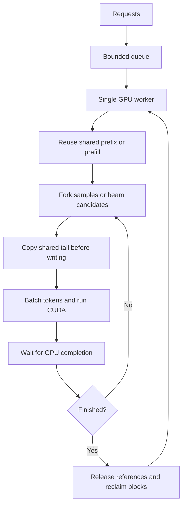

# Building a Qwen3 Inference Server

This project builds a Qwen3 inference server from CUDA Tile C++ implementations of individual transformer components. It starts by comparing those components against Hugging Face/PyTorch, then moves to a GPU-resident dense server with paged KV caching and continuous batching. The next milestones bring the same serving stack to Qwen3-30B-A3B and measure its performance against vLLM on H200 GPUs.

## Project stages

| Stage | Status | Scope |
| --- | --- | --- |
| 1 | Implemented | CUDA Tile transformer components and a PyTorch reference workflow |
| 2 | Implemented | Single-GPU dense Qwen3 serving, KV-cache optimizations, and an AIPerf benchmark harness |
| 3 | Planned | Qwen3-30B-A3B serving and a vLLM comparison on one H200 |
| 4 | Planned | Data and expert parallelism across 1–8 H200 GPUs, with a matched two-H200 vLLM comparison |
| 5 | Scope pending | Milestone and evaluation targets to be defined |

## Stage 1 — CUDA Tile components and reference checks

Implemented BF16 forward paths for RMSNorm, rotary positional embeddings (RoPE), attention, the MLP, and the decoder layer. Hugging Face/PyTorch generates reference cases, and SQLite stores the weights, inputs, configuration, and expected outputs so each CUDA component can be checked independently. The decoder layer composes these components, and a separate runner compares intermediate tensors and full-model logits with Hugging Face.

The Stage 1 breakdown records accumulated differences in the Qwen3-0.6B stress test. It identifies the MLP down-projection as a candidate for investigation. [Stage 1 breakdown](Stage_1_Breakdown.md) · [HF/CUDA logits comparison](HF_CUDA_logits_comparison.md)

## Stage 2 — Optimized dense inference server

Built a standalone serving path for dense Qwen3-0.6B and Qwen3-4B. It loads BF16 safetensors directly, keeps model weights, workspaces, and KV tensors on the GPU, and uses cuBLAS for projections and CUDA Tile kernels for operations including RoPE, KV writes, and paged attention.

- **Paged KV cache and prefix reuse.** Attention reads physical pages through per-sequence block tables. Requests can reuse complete blocks from an exact prefix, and branches use copy-on-write for shared partial blocks.
- **Continuous batching.** The scheduler combines decode rows with chunks of new prompts. Under KV-memory pressure it can evict unused prefixes or preempt requests and later recompute their cached history.
- **Serving and measurement.** The HTTP server supports streaming, parallel samples, and beam search. The AIPerf harness compares uncached, contiguous, and paged modes with controls for batching and prefix reuse, and provides a vLLM baseline.

### Request and GPU workflow

The validation notes record a 34-test H100 run that included tiny-model CUDA checks. Full-checkpoint comparisons and benchmark results have their own validation paths. [Stage 2 breakdown](Stage_2_Breakdown.md) · [Validation](stage_2/VALIDATION.md) · [Benchmark workflow](stage_2/BENCHMARK_BREAKDOWN.md)

## Stage 3 — Qwen3-30B-A3B on one H200

Fork the Stage 2 server and replace the Qwen3-4B model path with Qwen3-30B-A3B. Extend checkpoint loading and the decoder runtime to support the mixture-of-experts layers, including router scores, expert selection, and weighted combination of expert outputs. Reuse the paged KV cache and scheduler where the model interface allows. Validate routing and logits against a reference before profiling.

Run the custom server and vLLM sequentially on the same single H200. Use AIPerf with the same checkpoint revision, precision, workloads, and generation settings. Record time to first token, inter-token latency, end-to-end latency, throughput, and request errors across concurrency levels.

## Stage 4 — Data and expert parallelism across H200 GPUs

Extend the MoE server to support configurations with `K` H200 GPUs, where `1 ≤ K ≤ 8`. Use data parallelism to distribute independent requests and expert parallelism to distribute expert weights and computation. Dispatch routed tokens to the ranks that own their experts, then combine expert outputs before continuing the forward pass. Check multi-GPU output agreement against Stage 3 and measure expert load balance and communication overhead.

Profile the custom server with AIPerf and compare it with vLLM across **two H200 GPUs**. Use the same workloads and reporting metrics as Stage 3, and record the data and expert parallel configuration for each server.

## Stage 5 — Scope pending

Implementation and evaluation targets for Stage 5 are still to be defined.

## Run the implemented stages

- For module-level CUDA/PyTorch comparisons, use the example launchers in the [Stage 1 breakdown](Stage_1_Breakdown.md).
- For the dense server, start in `stage_2/` and follow the [build and serving instructions](stage_2/README.md).
- For the H100 benchmark workflow and result artifacts, see the [benchmark breakdown](stage_2/BENCHMARK_BREAKDOWN.md) and [full-checkpoint validation guide](stage_2/PHASE2.md).
