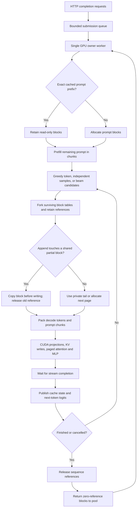

# Execution and ownership workflow

* HTTP threads never mutate the cache or call the model/tokenizer.
* Each live sequence and prefix entry holds one reference to each mapped block.
* Samples share full prefix blocks. Branches writing into a shared partial tail
  first make a private copy of that tail; different branches can then diverge.
* Beam pruning releases discarded candidates only after surviving candidates
  have acquired their references. Ordinary single-child steps reuse the parent.
* A completed GPU call is the boundary at which mappings can safely change.
* When memory fills, evict prefix-registry references first, then reset younger
  request groups for later recomputation. A still-live reference prevents reuse.
* Every scheduling iteration can admit new requests and remove finished ones.
